<div align="center">

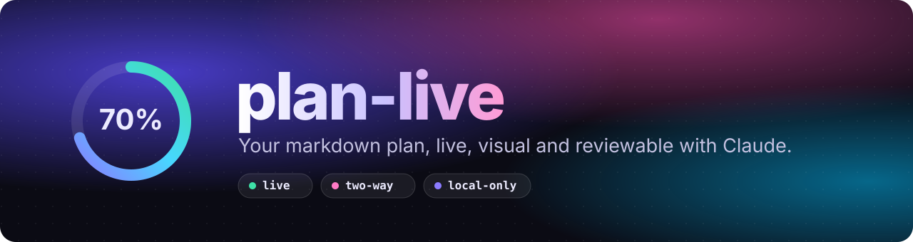

<br>

[](https://github.com/yahav10/plan-live/releases)


**[Install](#install)** · **[Quickstart](#quickstart)** · **[How it works](#how-the-loop-works)** · **[Tour](#a-quick-tour)** · **[Export](#export-everything)** · **[Themes](#themes)** · **[Write better plans](#write-plans-that-shine)** · **[FAQ](#faq)**

<br>

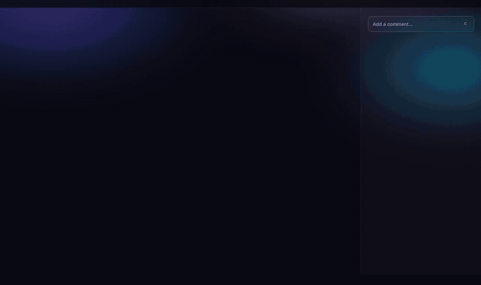

</div>

## Why

Claude writes great plans in markdown. Reading a 400-line `.md` to review them is another story.

| Without plan-live | With plan-live |
|---|---|
| Scroll a wall of text and lose your place | Section pill with a jump panel, progress per task, dependency graph |
| Reply in chat: "in step 3, change…" | Comment on the exact task or selected text |
| Hope Claude edits the right lines | Every change comes back as a diff you **Accept** or **Reject** |
| Re-read the file to see what moved | The page updates the moment the file changes, and flashes what changed |
| Send a markdown file to a teammate | Export a styled web page, PDF, CSV or diagram images |

The `.md` stays the **source of truth**. plan-live is a viewer and review loop on top of it, never a replacement.

## Install

```
/plugin marketplace add yahav10/plan-live
/plugin install plan-live@plan-live
```

Restart the session so the hooks load. You need **Node 20 or newer**. There is no `npm install`, no account and no network use after install.

## Quickstart

1. **Open a plan.** Ask Claude for one, or point at a file you have:

   ```
   /plan-live docs/plans/my-plan.md
   ```

   With no argument it opens the newest `docs/superpowers/plans/*.md`.
2. **Comment.** Click a task or a section, or select any text, then press `C` and write what should change. Tick `Suggest replacement text` to propose exact wording.
3. **Apply.** Press **Apply** (`⏎`). Claude is woken, edits the plan, and each change comes back as a diff in the review rail. **Accept** keeps it. **Reject** puts the old text back in your file.

<div align="center">
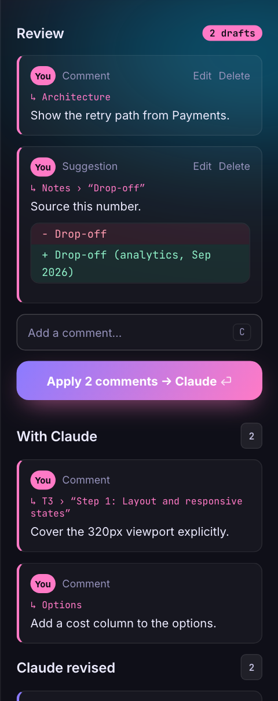
</div>

## How the loop works

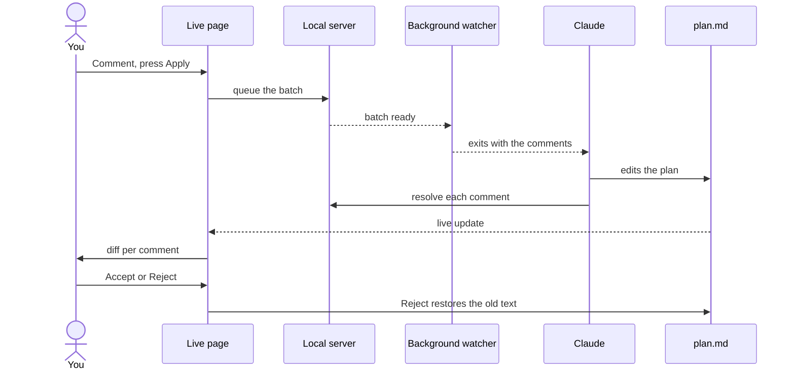

- **No typing to wake Claude.** `/plan-live` starts a background watcher. When you press Apply it exits, and that wakes Claude with your comments. If no watcher is running, your next prompt carries them instead.
- **Claude can't skip a comment.** A hook blocks the end of Claude's turn once while comments are unresolved.
- **Rejections are remembered.** Claude is told what you rejected, once, so it doesn't re-apply it.
- **Your edits are safe.** Every write re-reads the file first, so a checkbox toggle or a Reject never overwrites an edit Claude just made.

## A quick tour

<table>
<tr>
<td width="50%" valign="top">

**Dependency graph**<br>
Built from phrases like "depends on Task 1", "after T2" or "blocked by T4". The active task glows.

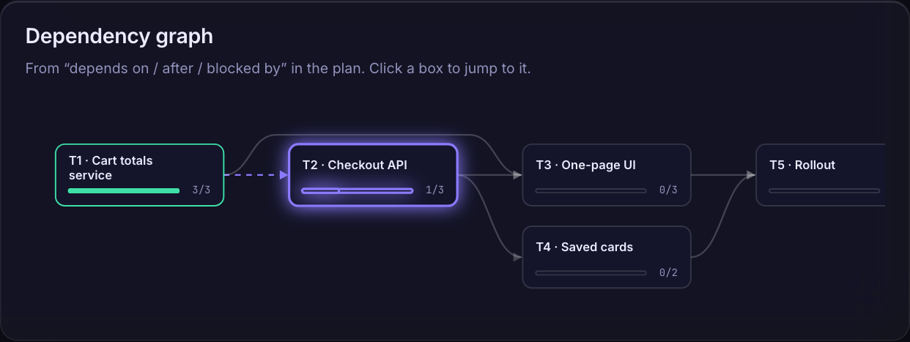

</td>
<td width="50%" valign="top">

**Task cards**<br>
Real checkboxes you can tick from the page. They write `[x]` into your file, with per-section progress.

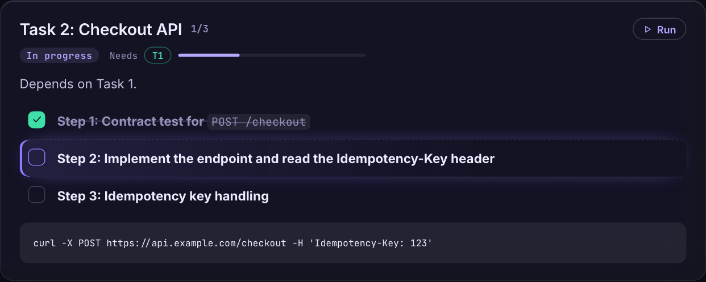

</td>
</tr>
<tr>
<td colspan="2" valign="top">

**Options side by side**<br>
An <code>approaches</code> block becomes comparison cards with effort, pros, cons and a recommended pick.

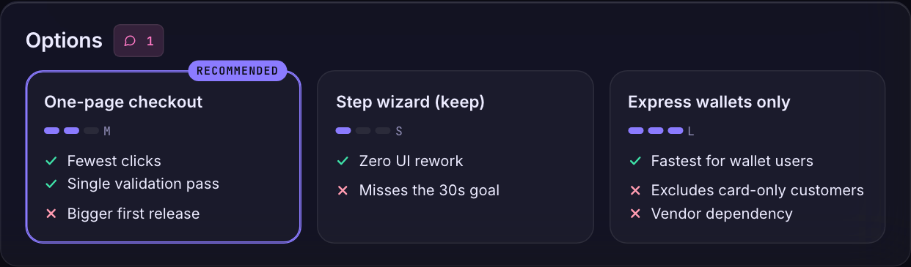

</td>
</tr>
<tr>
<td width="50%" valign="top">

**Architecture diagrams**<br>
Write `Browser -> Web : HTTPS` lines. Zoom, pan, click a box to trace its connections.

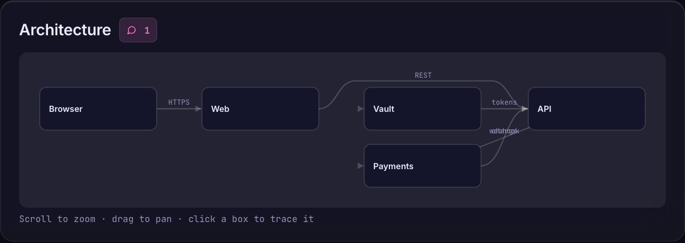

</td>
<td width="50%" valign="top">

**Mermaid, rendered**<br>
Flowcharts and sequence diagrams render from a bundled copy of Mermaid, offline.

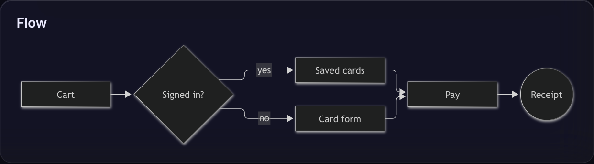

</td>
</tr>
</table>

Everything animates with purpose (a staggered entrance, a progress bar that sweeps, checkboxes that pop, comments that slide in) and goes completely still if your OS asks for **reduced motion**.

## Export everything

Open **Export** in the top bar. Every diagram also shows **SVG** and **PNG** buttons when you hover it.

<div align="center">
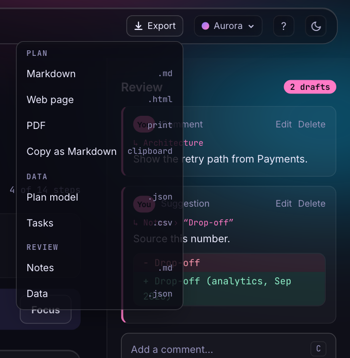
</div>

| Export | You get |
|---|---|
| **Markdown** | The plan file, byte for byte |
| **Web page** | One self-contained `.html` in your current theme. Fonts are inlined and there are no scripts, so it opens anywhere |
| **PDF** | Opens your browser's print dialog with the chrome hidden, always in light colours |
| **Copy as Markdown** | The source, on your clipboard |
| **Plan model** | The parsed plan as `.json` |
| **Tasks** | Every step as `.csv` (section, task, done, line). Formula-looking cells are neutralised |
| **Review notes** | Resolved, declined, with Claude, drafts and Claude's changes as `.md` or `.json` |
| **Diagrams** | Each graph or diagram as a styled `.svg` or a 2x `.png` |

## Finding your place

The top bar shows one pill with the section you are reading and a ring that fills as you scroll. Click it, or press `Ctrl`/`⌘` + `K`, to filter and jump between sections. Turn on **Reading spine** in the panel for a thin line along the left edge with one tick per section, sized by length and filled as you read. The choice is remembered.

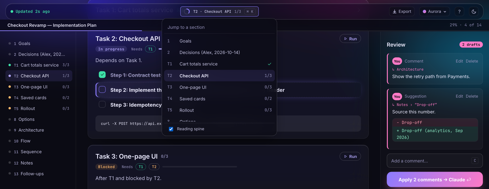

## Run a section

Task sections with unfinished steps get a **Run** button. Click it, read the confirm (it warns if the task depends on unfinished ones), and the run is queued as a request in the review rail. Press Apply and Claude works through that section's unchecked steps in order, ticking each box in the plan as it goes, so the page shows progress live. It stops at the first step it cannot finish and says why.

Runs travel the same loop as comments, so the watcher must be running (the confirm tells you if it is not), and Claude Code still asks permission before running anything that needs it. Only plan edits come back as diffs to accept or reject; code Claude writes elsewhere is not shown on the page.

## Progress at a glance

The top of the page shows where the plan stands, not just how much is done: a progress bar with the step count, four tiles (**Done**, **In progress**, **Blocked**, **To do**) that list their task numbers and jump to the first task of that kind when clicked, and a **Now** bar naming the current task with a **Focus** button.

A task is **done** when every step is ticked, **in progress** when some are ticked or it holds the plan's next unticked step, **blocked** when it has not started and depends on a task that is not finished, and **to do** otherwise. Every task heading shows the same status, its step count, and a **Needs** chip for each dependency, ticked when finished. Click a chip to jump there.

- **Outline.** From 1280px wide, a sticky column on the left lists every section with its status and step count, and follows where you are.
- **Focus page.** Press `F` or the **Focus** button to see one task: its status, the next step highlighted, all its steps and notes. The arrows browse other tasks, and it follows the current task on its own when you tick the last step. `F` returns to the plan.
- **Finished tasks fold.** A task whose steps are all ticked collapses to its heading. Click the heading to open it again. A finished task with comments still waiting stays open, and your choice is remembered for that plan file.
- **Title line.** Once the header scrolls away, a slim line shows the plan title and `29% · 14 of 49`, with the progress along its edge. Click it to go back to the top.

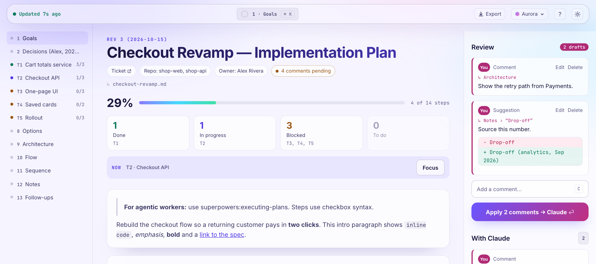

## On a phone

Under 760px wide the page becomes a phone layout: a bottom bar with **Plan**, **Now** (the focus page) and **Review** tabs, a comment button and an alerts switch. A line above it says what is waiting ("2 changes from Claude to review", "Claude is working on 1 comment…", "1 draft ready") and opens Review when tapped. Tap a step and then the comment button, or select text, and the comment box opens as a sheet above the keyboard. Tables become one-line rows you tap to open. Turn on **alerts** and the page gives a tone and a buzz when Claude answers a comment or proposes a change, while the page is open.

plan-live still listens on **127.0.0.1 only**. To use it from a phone you need a tunnel you control, for example one that forwards your machine's port.

## Callouts, dependencies and shortcuts

**Callouts.** A plain `>` quote renders as a quote, and a GitHub-style alert becomes a coloured box with an icon:

```
> [!WARNING] Careful
> Never run this on prod.
```

The kinds are `NOTE`, `TIP`, `IMPORTANT`, `WARNING` and `CAUTION`. Text after the kind replaces the label. The same file still reads fine on GitHub.

**Dependencies.** Write them in sentences, and lists work: `Depends on Task 5, Task 6 and Task 7`, `Depends on Task 1, 2 or 3`, `After T1 & T2`. The graph draws an arrowhead for each one, reorders boxes to cut crossings, runs a long edge above the boxes it skips, wraps long titles onto two lines, and shows a progress bar in each task box. A wide graph scrolls inside its card so the text stays readable.

**Shortcuts.** Press `?` or click the question-mark button to see them all. The hints show `⌘` on a Mac and `Ctrl` elsewhere.

## Images and animation

Put an image on its own line and it shows up in the page:

```

```

Paths are relative to the plan's folder. plan-live serves png, jpg, gif, webp, avif and svg from there and nothing else, never anything outside the folder, and never your plan or review files. Remote images are not loaded, so opening a plan cannot ping a tracker.

For a small animation, use an `embed` block with HTML, CSS and JavaScript in it (add `height=240` to set its height):

````
```embed height=240
<style>.dot { animation: beat 1.4s infinite; }</style>
<i class="dot"></i>
```
````

An embed is click to run. It runs in a sandboxed frame with no access to the page, your cookies, the review API or the network, so a plan from someone else's repo cannot do anything with it. It receives the theme's colours as CSS variables (`--accent`, `--ink`, `--muted`, `--bg` and a few more), so it matches the current theme. Try `docs/examples/media-plan.md`.

**In exports.** The HTML export embeds each image in the file and keeps each animation as a click-to-run frame with the same isolation as the live page (a sandboxed frame with its own no-network policy), so one exported file shares the whole plan. To allow that, an export that contains an animation allows inline script in its page policy; an export without one stays fully script-free. The PDF export swaps each animation for a **still frame**, drawn in light colours.

**Make your animation print well.** The still frame is your embed with `<html data-still="true">`, all CSS animations and transitions switched off, and a normal page otherwise. So draw the finished diagram as the resting state and animate on top of it. If you drive things from JavaScript, check `document.documentElement.dataset.still` and render the end state without timers. Anything that is hidden until an animation reveals it (a caption at `opacity: 0`, for example) needs a `html[data-still]` rule that shows it.

**Screenshots in a plan.** Images come from the plan's folder, so a script can keep them fresh: have a Playwright spec write `shots/*.png` next to the plan and refer to them with ``. Re-run the spec and the page shows the new pictures.

**Writing SVG in an embed.** Monospace text runs wider than you expect. Use the body font for small labels, or measure the text before you size the box around it.

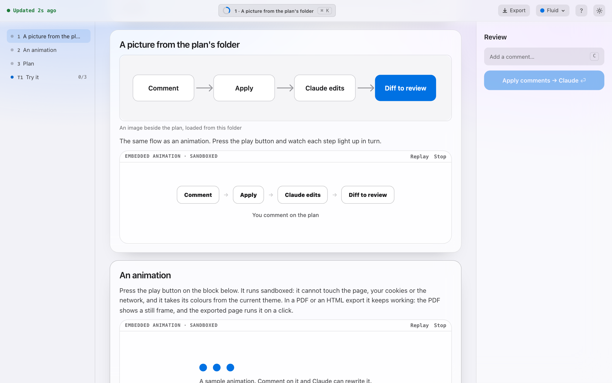

## Themes

Five themes, each in light and dark. Switch from the top bar or press `T` and `D`.

<table>
<tr>
<td align="center" width="20%">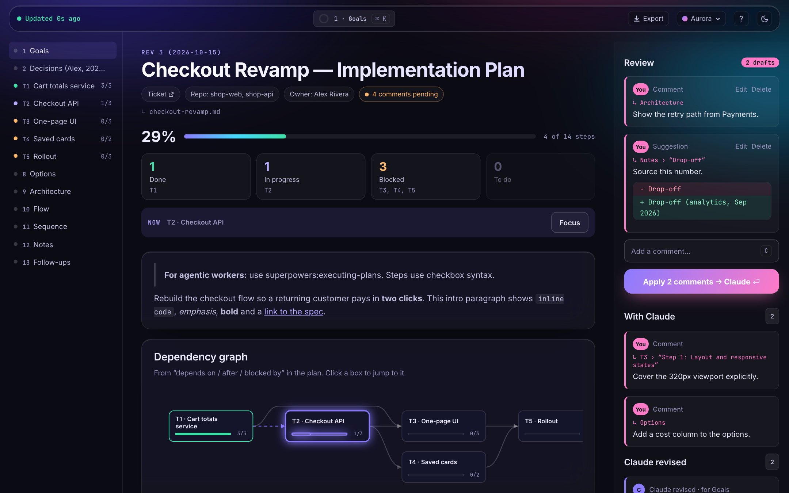<br><b>Aurora</b><br><sub>gradient glow, soft glass</sub></td>
<td align="center" width="20%">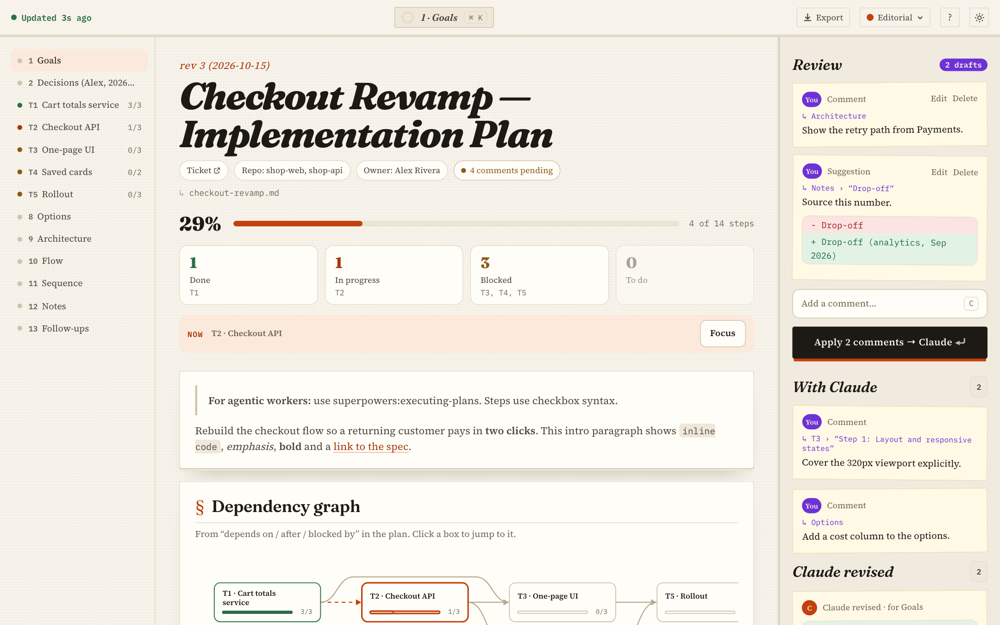<br><b>Editorial</b><br><sub>serif type, paper, sticky-note comments</sub></td>
<td align="center" width="20%">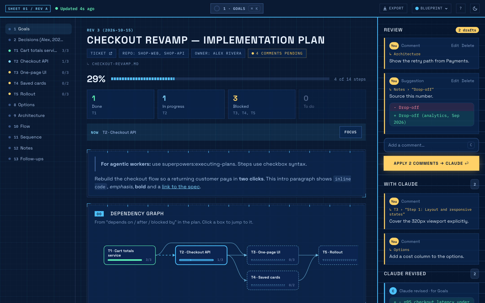<br><b>Blueprint</b><br><sub>drafting grid, corner brackets, marching dashes</sub></td>
<td align="center" width="20%">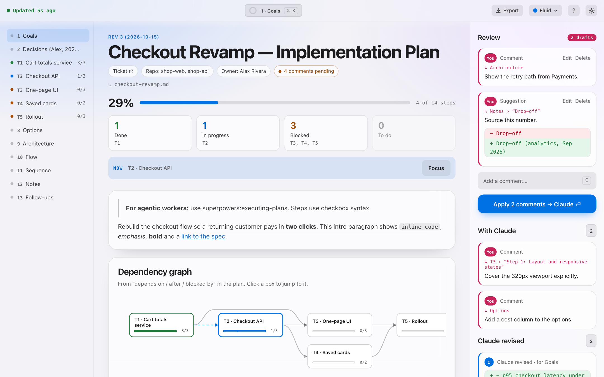<br><b>Fluid</b><br><sub>system font, frosted materials, one blue accent</sub></td>
<td align="center" width="20%">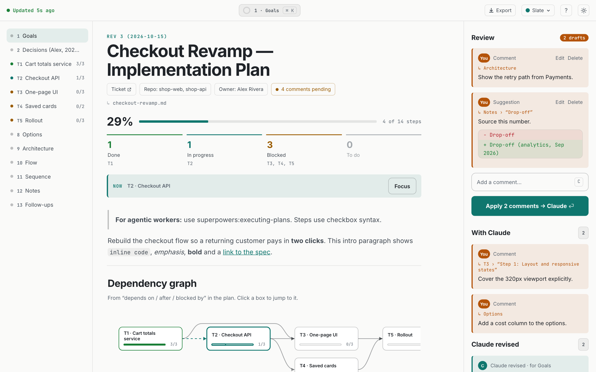<br><b>Slate</b><br><sub>flat and quiet, teal accent, sections read like a document</sub></td>
</tr>
</table>

Every text colour in every theme and mode passes the WCAG AA 4.5:1 contrast test, and that is checked in the test suite. Set your default in `~/.claude/plan-live.json`:

```json
{ "theme": "editorial", "mode": "auto" }
```

Precedence: URL parameters, then your last choice in the browser, then `--theme` and `--mode`, then that file, then Aurora in auto mode.

## Write plans that shine

plan-live renders any markdown. These conventions unlock more.

<table>
<tr>
<td valign="top" width="50%">

````markdown
## Goals
- Cut checkout time to under 30s

### Task 1: Totals service
- [x] **Step 1: Write the failing test**
- [ ] **Step 2: Implement**

### Task 2: Checkout API
Depends on Task 1.
- [ ] **Step 1: Contract test**
````

</td>
<td valign="top" width="50%">

````markdown
```approaches
name: One-page checkout
effort: M
pick: yes
+ Fewest clicks
- Bigger first release
```

```architecture
Browser -> Web : HTTPS
Web -> API : REST
```
````

</td>
</tr>
</table>

- `### Task N: …` headings become their own section (they read `T1`, `T2`… in the pill and the jump panel, matching the dependency graph).
- "depends on", "after" and "blocked by" followed by `Task 1` or `T1` draw the dependency graph.
- <code>```approaches</code> and <code>```architecture</code> blocks become cards and diagrams, and a <code>```mermaid</code> block renders as a diagram. Anything else in a fence stays plain code: `#`, `- [ ]` and `|` lines inside fences are never parsed as headings, tasks or tables.
- `<!-- short: Graph -->` under a heading sets its short label in review notes.
- Metadata lines like `**Ticket:** https://…` become chips in the header.

Want to see everything at once? Open the bundled example:

```
/plan-live docs/examples/demo-plan.md
```

## Reference

**Command**

```
/plan-live [plan.md] [--theme aurora|editorial|blueprint|fluid|slate] [--mode auto|light|dark]
```

**Keyboard**

| Key | Action |
|---|---|
| `C` | Comment on the focused section or task |
| `⏎` | Apply draft comments |
| `Ctrl` / `⌘` + `K` | Open the jump panel: type to filter sections, arrows and `⏎` to jump, `Esc` to close |
| `J` / `K` | Next / previous section |
| `F` | Focus on the current task, and back |
| `?` | Show every shortcut |
| `T` / `D` | Cycle theme / cycle light, dark, auto |

**CLI** (what the plugin runs for you; handy for scripting)

```
node bin/plan-live.mjs serve   <plan.md> [--open] [--theme t] [--mode m]
node bin/plan-live.mjs watch   <plan.md>
node bin/plan-live.mjs resolve <plan.md> <commentId> --status resolved|declined --note "…"
node bin/plan-live.mjs status  <plan.md>
node bin/plan-live.mjs stop    <plan.md>
```

**Comment states:** `draft` (yours, editable) → `queued` (sent to Claude) → `resolved` or `declined` (with Claude's note). Claude's edits show up as revisions you accept or reject.

## Privacy and safety

- The server listens on **127.0.0.1 only**, on a random port, and every request needs a random per-session key.
- Requests with a foreign `Host` or `Origin` are refused, so other web pages can't drive it.
- Plan text is rendered as inert text: HTML and `javascript:` links in a plan can't run. Mermaid runs in strict mode.
- Review state lives next to your plan in `<plan>.review.json`. Add it to `.gitignore` unless you want the review history in git.
- Nothing is sent anywhere. The only network use is `/plugin install`.

## FAQ

<details><summary>Does it change my plan file?</summary>
Only in three cases: you tick a checkbox, you reject a change, or Claude edits the plan to answer your comments. Everything else is read-only.
</details>

<details><summary>Does Claude really react without me typing?</summary>
Yes. Apply makes the background watcher exit, and that wakes Claude with your comments. If the watcher isn't running, your next prompt carries the comments.
</details>

<details><summary>Does it work with plans that aren't from superpowers?</summary>
Yes, any markdown works. Plans with <code>### Task N</code> headings and <code>- [ ]</code> steps get the most out of it (progress, graph).
</details>

<details><summary>Can I share a plan with someone who doesn't use Claude Code?</summary>
Export a <b>Web page</b> or a <b>PDF</b>. The web page is one file with fonts and styles inlined.
</details>

<details><summary>Windows?</summary>
Not tested yet. macOS and Linux are supported. Reports and fixes are welcome.
</details>

## Troubleshooting

| Symptom | Fix |
|---|---|
| Browser didn't open | Run `/plan-live` again, or open the URL it prints |
| Server fails to start with a syntax or `fetch` error | Your Node is older than 20. Upgrade it, then restart the session |
| The page says "offline" | The server stopped. Run `/plan-live` again |
| Apply is greyed out | Apply sends draft comments. Add one first (`C`) |
| Hooks seem inactive | Restart the Claude Code session after installing |
| "missing or wrong key" | You opened an old URL. Run `/plan-live` again for a fresh one |

## Develop

```
git clone https://github.com/yahav10/plan-live && cd plan-live
npm install
npm run vendor      # copies fonts and Mermaid into ui/vendor
npm test            # unit tests
npm run test:e2e    # browser tests
```

Try your checkout without publishing:

```
/plugin marketplace add /path/to/plan-live
/plugin install plan-live@plan-live
```

Regenerate the README visuals from the bundled example plan with `npm run screenshots` and `npm run demo-gif` (the GIF needs `ffmpeg`; pass an output path such as `node scripts/demo-gif.mjs demo.mp4` to also write an MP4).

See [CONTRIBUTING.md](CONTRIBUTING.md) before opening a pull request, [SECURITY.md](SECURITY.md) to report a vulnerability, and [CHANGELOG.md](CHANGELOG.md) for what changed.

Design notes and decisions live in [`docs/superpowers/specs/`](docs/superpowers/specs/2026-10-08-plan-live-design.md).

## Help wanted

plan-live is young and I would like to hear where it breaks.

- Windows is untested. If you try it there, open an issue with what happened, good or bad.
- An idea I would take a pull request for: PDF page breaks.
- If it saved you time on a long plan, a star helps other people find it.

## License

MIT. Bundled fonts and Mermaid keep their own licences, see [THIRD_PARTY_NOTICES.md](THIRD_PARTY_NOTICES.md).
