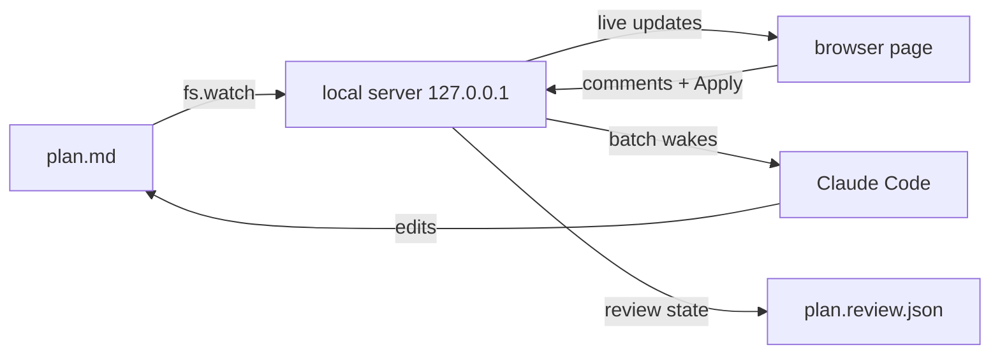

<div align="center">

# plan-live

**Turn the markdown plan Claude wrote into a live, interactive page, and review it with Claude in the loop.**


</div>

## Why

Plans in markdown are easy for Claude to write and hard for you to read. plan-live renders any plan as a page you can scan, and closes the loop: **comment, press Apply, and Claude revises the plan while you watch.**

- **Live.** The page updates within a second of any edit to the `.md`.
- **Two-way.** Comment on a section, a task or selected text. Apply sends the batch to Claude without you typing a prompt.
- **Reviewable.** Every change comes back as a diff. Accept keeps it. Reject puts the old text back in the file.
- **Yours.** The `.md` stays the source of truth. Nothing leaves your machine: the server listens on `127.0.0.1` behind a per-session key.
- **Good to look at.** Three themes, each in light and dark.

## Install

```
/plugin marketplace add yahav10/plan-live
/plugin install plan-live@plan-live
```

Restart the session so the hooks load. Needs **Node 20+**. No `npm install`, no account, no network after install.

## Quickstart

1. Ask Claude for a plan, or point at one you have: `/plan-live docs/plans/my-plan.md`
2. Your browser opens. Click **Comment** on any section, task or selected text, and write what should change.
3. Press **Apply** (`⏎`). Claude is woken, edits the plan, and the page shows a diff for each comment. **Accept** or **Reject**.

```
/plan-live docs/plans/my-plan.md
/plan-live docs/plans/my-plan.md --theme blueprint --mode dark
```

## How it works



The page never edits your plan on its own, except for two things you asked for explicitly: ticking a checkbox, and rejecting a change. Review state lives beside the plan in `<plan>.review.json`, so add it to `.gitignore` or commit it, your call.

## What you get

| | |
|---|---|
| **Sections strip** | One-word tabs with a progress underline, always in view |
| **Task cards** | Checkboxes you can tick from the page, with per-task progress |
| **Dependency graph** | Built from "depends on / after / blocked by" phrases in your tasks |
| **Approach cards** | Side-by-side options with effort, pros, cons and the pick |
| **Architecture diagram** | From a small `architecture` block, or any Mermaid block |
| **Review rail** | Draft, queued, picked up, resolved or declined, per comment |
| **Diff per change** | Accept or Reject each change Claude made for a comment |
| **Themes** | Aurora, Editorial, Blueprint, each light and dark (`T`, `D`) |
| **Motion** | Smooth scrolling, staggered entrance, progress that sweeps and counts up, checkbox pops, comments that slide in. Off under reduced-motion |

Works on any markdown plan. Plans with `### Task N` headings and `- [ ]` steps get the most from it.

## Themes

<table>
<tr>
<td align="center"><br><b>Aurora</b></td>
<td align="center"><br><b>Editorial</b></td>
<td align="center"><br><b>Blueprint</b></td>
</tr>
</table>

Pick one in the top bar, with `--theme` and `--mode`, or set a default in `~/.claude/plan-live.json`:

```json
{ "theme": "editorial", "mode": "auto" }
```

Precedence: URL, then your last choice in the browser, then flags, then that file, then Aurora in auto mode.

## Richer visuals in your plan

````markdown
```approaches
name: Local server
effort: M
pick: yes
+ Live reload
- One more process
```

```architecture
Browser -> Server : SSE
Server -> Plan : fs.watch
```
````

Mermaid code blocks render as diagrams. Tasks that say "depends on Task 1", "after T2" or "blocked by T4" appear in the dependency graph.

## Keyboard

| Key | Action |
|---|---|
| `C` | Comment on the focused section |
| `⏎` | Apply draft comments |
| `J` / `K` | Next / previous section |
| `T` / `D` | Cycle theme / toggle light, dark |

## FAQ

<details><summary>Does it change my plan file?</summary>
Only when you tick a checkbox, reject a change, or when Claude edits it in answer to your comments. Everything else is read-only.
</details>

<details><summary>Is it safe to run?</summary>
The server binds to 127.0.0.1 on a random port and requires a random 32-byte key on every request. It serves only the plan you opened. Plan content is rendered as inert text, never as HTML or script.
</details>

<details><summary>Does Claude really react without me typing?</summary>
Yes. `/plan-live` starts a background watcher. Apply makes it exit, which wakes Claude with your comments. If the watcher is not running, your next prompt carries the comments instead.
</details>

<details><summary>Windows?</summary>
Not tested yet. macOS and Linux are supported. Reports and fixes are welcome.
</details>

## Troubleshooting

| Symptom | Fix |
|---|---|
| Browser did not open | Run `/plan-live` again, or open the URL it prints |
| Server fails to start with a syntax or `fetch` error | Node is older than 20. Upgrade it, then restart the session |
| Page says "offline" | The server stopped. Run `/plan-live` again |
| Apply is greyed out | Apply sends draft comments. Add one first (`C`) |
| Hooks seem inactive | Restart the Claude Code session after install |

## Develop

```
git clone https://github.com/yahav10/plan-live && cd plan-live
npm install
npm run vendor
npm test
npm run test:e2e
```

Try your checkout without publishing:

```
/plugin marketplace add /path/to/plan-live
/plugin install plan-live@plan-live
```

Design and decisions: [`docs/superpowers/specs/`](docs/superpowers/specs/2026-10-08-plan-live-design.md).

## License

MIT. Bundled fonts and Mermaid keep their own licences, see [THIRD_PARTY_NOTICES.md](THIRD_PARTY_NOTICES.md).
