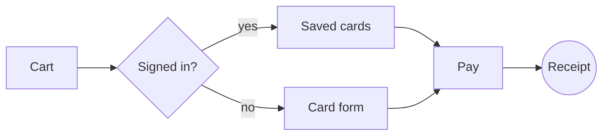
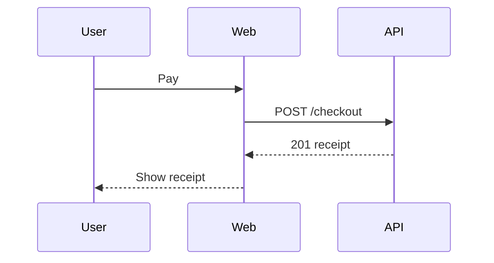

# Checkout Revamp — Implementation Plan — rev 3 (2026-10-15)

**Ticket:** https://example.com/browse/SHOP-42

**Repo:** shop-web, shop-api

**Owner:** Alex Rivera

> **For agentic workers:** use superpowers:executing-plans. Steps use checkbox syntax.

Rebuild the checkout flow so a returning customer pays in **two clicks**. This intro paragraph shows `inline code`, *emphasis*, **bold** and a [link to the spec](https://example.com/spec).

## Goals
- Cut checkout time from 90s to under 30s
- Keep the *cart* source of truth in the API
  - Nested point: cart merges on login
  - Another nested point: guest carts expire after 7 days
- Zero downtime rollout behind a flag

## Decisions (Alex, 2026-10-14)

| # | Decision | Consequence | Status |
|---|---|---|---|
| D1 | Guard totals at the API | No client trust | Agreed |
| D2 | One-page checkout | Remove step wizard | Agreed |
| D3 | Saved cards via vault | PCI scope shrinks | Open |

### Task 1: Cart totals service

- [x] **Step 1: Write the failing test**
- [x] **Step 2: Implement `computeTotals()`**
- [x] **Step 3: Commit**

```js
export function computeTotals(items) {
  return items.reduce((sum, i) => sum + i.price * i.qty, 0);
}
```

### Task 2: Checkout API

Depends on Task 1.

- [x] **Step 1: Contract test for `POST /checkout`**
- [ ] **Step 2: Implement the endpoint**
- [ ] **Step 3: Idempotency key handling**

```bash
curl -X POST https://api.example.com/checkout -H 'Idempotency-Key: 123'
```

### Task 3: One-page UI

After T1 and blocked by T2.

- [ ] **Step 1: Layout and responsive states**
- [ ] **Step 2: Wire the form to the API**
- [ ] **Step 3: Empty and error states**

### Task 4: Saved cards

Depends on Task 2.

- [ ] **Step 1: Vault client**
- [ ] **Step 2: Card picker component**

### Task 5: Rollout

Depends on Task 3 and Task 4.

- [ ] **Step 1: Feature flag at 5%**
- [ ] **Step 2: Watch error budget for 24h**
- [ ] **Step 3: Ramp to 100%**

## Options
```approaches
name: One-page checkout
effort: M
pick: yes
+ Fewest clicks
+ Single validation pass
- Bigger first release
name: Step wizard (keep)
effort: S
+ Zero UI rework
- Misses the 30s goal
name: Express wallets only
effort: L
+ Fastest for wallet users
- Excludes card-only customers
- Vendor dependency
```

## Architecture
```architecture
Browser -> Web : HTTPS
Web -> API : REST
API -> Vault : tokens
API -> Payments : charge
Payments -> API : webhook
```

## Flow


## Sequence


## Notes
Fenced code must stay code, even when it looks like markdown:

```bash
# not a heading
- [ ] not a task
| not | a table |
```

| Metric | Today | Target |
|---|---|---|
| Time to pay | 90s | 30s |
| Drop-off | 41% | 20% |

## Follow-ups
- Apple Pay and Google Pay
- Order-status emails
