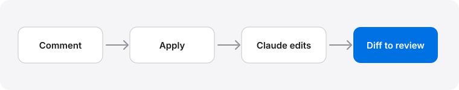

# Images and Animation — Example Plan — rev 1 (2026-10-19)

**Owner:** Example

Plans can carry pictures and small animations. Open this file with `/plan-live docs/examples/media-plan.md` to see both.

## A picture from the plan's folder



The same flow as an animation. Press the play button and watch each step light up in turn.

```embed height=190
<style>
  .wrap { height: 100%; display: grid; place-items: center; font: 600 13px var(--font-body, system-ui); color: var(--ink, #1d1d1f); }
  .flow { display: flex; align-items: center; gap: 10px; }
  .node { padding: 12px 16px; border-radius: 12px; border: 1px solid var(--line-strong, #c7c7cc); background: var(--card, #fff); animation: lit 6s ease-in-out infinite; }
  .node:nth-of-type(2) { animation-delay: 1.5s; } .node:nth-of-type(3) { animation-delay: 3s; } .node:nth-of-type(4) { animation-delay: 4.5s; }
  .arrow { color: var(--muted, #6e6e73); opacity: .3; animation: go 6s ease-in-out infinite; }
  .arrow:nth-of-type(1) { animation-delay: .9s; } .arrow:nth-of-type(2) { animation-delay: 2.4s; } .arrow:nth-of-type(3) { animation-delay: 3.9s; }
  .cap { position: relative; height: 20px; margin-top: 18px; text-align: center; color: var(--muted, #6e6e73); font-weight: 500; }
  .cap span { position: absolute; inset: 0; opacity: 0; animation: say 6s ease-in-out infinite; }
  .cap span:nth-child(2) { animation-delay: 1.5s; } .cap span:nth-child(3) { animation-delay: 3s; } .cap span:nth-child(4) { animation-delay: 4.5s; }
  @keyframes lit { 0%, 20% { border-color: var(--accent, #0071e3); background: var(--accent-soft, rgba(0,113,227,.12)); color: var(--accent-ink, #0066cc); transform: translateY(-3px) scale(1.06); } 26%, 100% { border-color: var(--line-strong, #c7c7cc); background: var(--card, #fff); color: var(--ink, #1d1d1f); transform: none; } }
  @keyframes go { 0%, 8% { opacity: .3; transform: none; } 14% { opacity: 1; transform: translateX(4px); } 24%, 100% { opacity: .3; transform: none; } }
  @keyframes say { 0% { opacity: 0; } 4%, 20% { opacity: 1; } 25%, 100% { opacity: 0; } }
  html[data-still] .cap span:first-child, .still .cap span:first-child { opacity: 1; }
  @media (prefers-reduced-motion: reduce) { * { animation: none !important; } .cap span:first-child { opacity: 1; } }
</style>
<div class="wrap"><div>
  <div class="flow"><b class="node">Comment</b><i class="arrow">→</i><b class="node">Apply</b><i class="arrow">→</i><b class="node">Claude edits</b><i class="arrow">→</i><b class="node">Diff to review</b></div>
  <div class="cap"><span>You comment on the plan</span><span>Apply sends the batch to Claude</span><span>Claude edits the markdown</span><span>You accept or reject each change</span></div>
</div></div>
```

## An animation

Press the play button on the block below. It runs sandboxed: it cannot touch the page, your cookies or the network, and it takes its colours from the current theme. In a PDF or an HTML export it keeps working: the PDF shows a still frame, and the exported page runs it on a click.

```embed height=200
<style>
  .stage { height: 100%; display: grid; place-items: center; font: 600 14px var(--font-body, system-ui); }
  .row { display: flex; gap: 14px; align-items: center; }
  .dot { width: 18px; height: 18px; border-radius: 50%; background: var(--accent, #0071e3); animation: beat 1.4s ease-in-out infinite; }
  .dot:nth-child(2) { animation-delay: .2s; } .dot:nth-child(3) { animation-delay: .4s; }
  .cap { margin-top: 14px; color: var(--muted, #6e6e73); font-weight: 500; text-align: center; }
  @keyframes beat { 0%, 100% { transform: scale(.7); opacity: .45; } 50% { transform: scale(1.15); opacity: 1; } }
  @media (prefers-reduced-motion: reduce) { .dot { animation: none; } }
</style>
<div class="stage"><div><div class="row"><i class="dot"></i><i class="dot"></i><i class="dot"></i></div><div class="cap">A sample animation. Comment on it and Claude can rewrite it.</div></div></div>
```

## Plan

### Task 1: Try it

- [ ] **Step 1: Open this plan**
- [ ] **Step 2: Run the animation**
- [ ] **Step 3: Switch theme and watch it follow**
